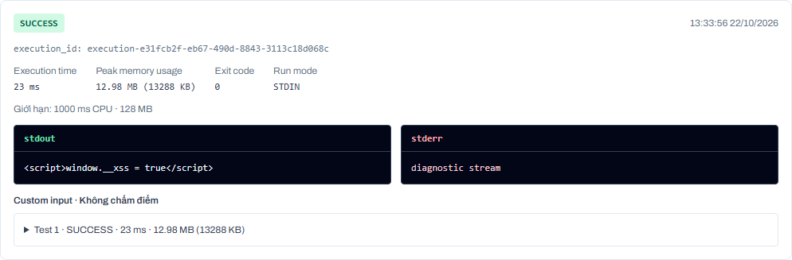
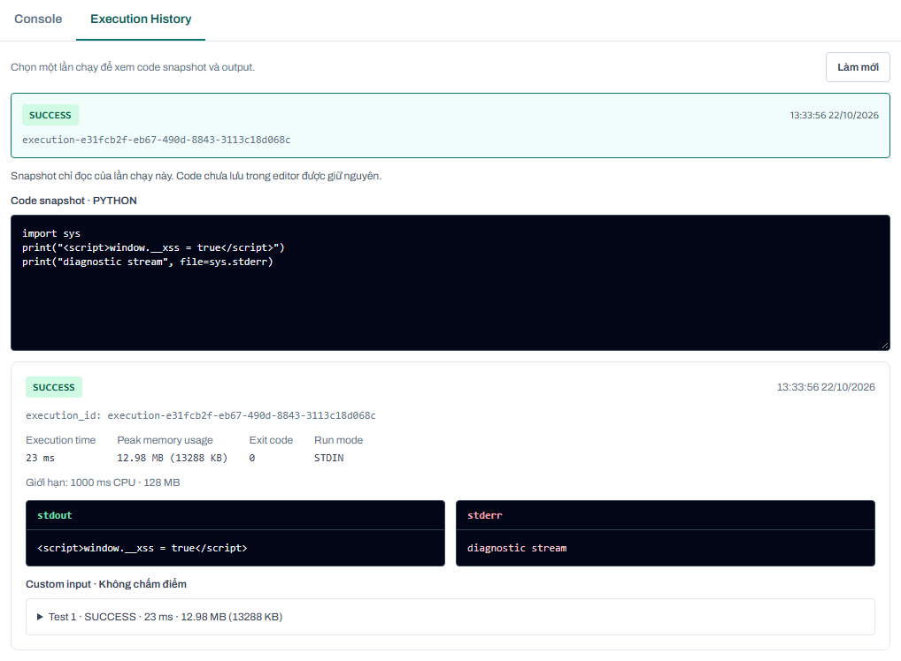

# US-07b — Console và Execution History

Kiểm chứng local ngày 22/10/2026 trên branch `feature/us-07b-console-history`.
AC-07b đạt trong môi trường local, với backend thật, Chromium và sandbox Docker thật.

## Branch và phụ thuộc

- Branch được tạo từ `origin/main` tại `1fb1dcfaf15043293947751523a7fd0b0fbd4ba2`.
- `main` chưa có sandbox của US-07.1. Sáu commit phụ thuộc đã được cherry-pick:
  sandbox, cấu hình CI build image, execution queue, API, Run controls và lecturer history.
- Không mang theo thay đổi runner preflight và các script Debian ngoài phạm vi phụ thuộc.
- PR nhắm tới `staging`; kết quả bên dưới là kiểm thử local, chưa xác nhận deploy
  staging/production.

## Đối chiếu acceptance và business rules

| Yêu cầu | Kết quả | Bằng chứng |
| --- | --- | --- |
| AC-07b: mỗi Run có output/error riêng | PASS | Hai lần chạy với code và kết quả khác nhau có ID riêng; API trả lại đúng snapshot, stdout/stderr; history mở đúng lần chạy |
| Tách stdout và stderr | PASS | Hai vùng output riêng, có nhãn và màu; cả console, từng test và lecturer history dùng stream riêng |
| Execution time theo ms | PASS | `runtimeMs` từ supervisor; test sleep 50 ms xác nhận duration ít nhất 50 ms; tổng Run bằng tổng duration của các test |
| Memory usage theo KB/MB | PASS | `memoryUsageKb` từ Linux `wait4().ru_maxrss`; test cấp phát 20 MB có peak ít nhất 20 MB; UI hiển thị cả MB và KB |
| Output lớn bị cắt và có cảnh báo | PASS | Run in 100.000 ký tự trả `outputTruncated`; UI hiện cảnh báo; tổng output nhiều test cũng được giới hạn và gắn cờ |
| HTML/script output an toàn | PASS | React render text trong `pre`, không dùng HTML/Markdown; Chromium hiển thị nguyên script và `window.__xss` không được tạo |
| History có timestamp/status badge | PASS | Các mục có timestamp, trạng thái và execution ID, thứ tự mới nhất trước; hỗ trợ tải thêm sau 100 mục |
| History giữ qua reload | PASS | Test reload trang Chromium; test API restart backend, đăng nhập lại, đối chiếu nguyên kết quả trước/sau |
| Xem snapshot không đè editor | PASS | Snapshot là textarea read-only; draft Monaco giữ nguyên sau chọn lịch sử; không gọi API save khi xem history |
| Phân biệt lỗi hạ tầng/lỗi code | PASS | `INTERNAL_ERROR` có nhãn và thông báo hạ tầng; `RUNTIME_ERROR` có nhãn lỗi chương trình và stderr riêng; kiểm chứng bằng image không tồn tại và `raise ValueError` |
| Student chỉ xem lịch sử của mình | PASS | Student khác nhận list rỗng và 404 khi truy cập execution ID không thuộc mình |
| Lecturer xem qua monitoring | PASS | Lecturer được phép đọc list/detail và lịch sử assignment version; snapshot/console dùng component chung |
| Admin không truy cập trực tiếp | PASS | List/detail execution và version history trả 403; workspace hiện có cũng chặn admin |

## Các phần đã triển khai

- `frontend/src/features/~_private/~course/~$id/components/execution-panel.tsx`:
  console, status badge, history có phân trang/refresh, cập nhật Run đang xử lý,
  snapshot read-only, navigation bàn phím giữa hai tab và cảnh báo truncation.
- `student-lab-workspace.tsx` và `dsa-lab-management.tsx`:
  gắn panel vào cả hai workspace hiện có. Run gửi snapshot của code đang sửa,
  không tự save code. Save và Submit giữ luồng riêng.
- `assignment-editor.tsx`: lecturer xem cùng snapshot/console cho từng execution.
- `backend/executions.mjs`: lưu metric từng test, peak memory của Run,
  tổng duration; cắt aggregate output theo UTF-8 bytes và không tách dở ký tự.
- `deploy/sandbox/supervisor.py`: đo peak resident memory riêng từng subprocess,
  tách compilation khỏi execution thành công, trả metric về worker.
- `backend/codepulse.mjs`: cursor `before` cho history; giữ nguyên kiểm tra role,
  owner và quyền quản lý classroom.

## Dữ liệu và API

Repo hiện dùng storage JSON bền vững, không có ORM/schema SQL cho bảng
`Execution`/`ExecutionAttempt`. Triển khai tiếp nối storage của US-07.1:

- `codepulse-executions.json`: một record cho mỗi Run, ID UUID, source snapshot,
  hash, timestamp, trạng thái, stdout/stderr và metrics.
- `results[]`: kết quả từng test attempt của Run, gồm duration, memory và streams.
- `codepulse-workspaces.json`: giữ tham chiếu/kết quả Run mới nhất của workspace;
  Run không thay đổi `sourceCode` đã save.

```text
GET /api/codepulse/executions?workspaceId=<id>
GET /api/codepulse/executions?workspaceId=<id>&before=<execution_id>
    -> { items: [...], nextCursor: <execution_id> | null }
GET /api/codepulse/executions/<execution_id>
    -> { item: { id, sourceCode, stdout, stderr, runtimeMs, memoryUsageKb, ... } }
```

History phân trang 100 mục/lần. ID hiển thị dưới nhãn `execution_id` là cùng
`item.id` được dùng ở endpoint detail; không phát sinh một ID khác ở frontend.

## Kết quả kiểm tra

| Kiểm tra | Kết quả |
| --- | --- |
| `docker build -t codepulse-sandbox:1 deploy/sandbox` | PASS |
| `npm --prefix backend test` | 40/40 PASS, không skip; bao gồm Python/C++ thật, lỗi runtime, CPU/wall/memory/output limit và isolation |
| `cd frontend` rồi `npx vitest run` | 11/11 PASS |
| `npm --prefix frontend run check-types` | PASS |
| `npm --prefix frontend run build` | PASS |
| `npm --prefix frontend run lint` | PASS |
| `npm run deploy:test` | 10/10 PASS |
| `git diff --check` | PASS |
| Chromium với API và Docker thật | 7/7 tình huống PASS; không có page error; desktop 1440px, mobile 390px |

Các test regression nằm trong `backend/test/executions.test.mjs`,
`backend/test/run-code.test.mjs`, `backend/test/sandbox.test.mjs`,
`execution-panel.test.tsx` và `student-lab-workspace.test.tsx`.

Script chạy browser, dữ liệu fixture và ảnh local ở `output/us-07b/`, được exclude
khỏi Git. Script này dùng Playwright đã cài ở repo `test-E2E` bên cạnh. Kết quả:
`browser-results.json`, `console-desktop.png`, `history-desktop.png`,
`truncated-output.png`, `history-mobile.png`.

Ảnh phục vụ review được lưu trong repo:





## Cách kiểm tra thủ công

1. Build sandbox image, chạy backend và frontend. Đăng nhập student có LAB đang
   mở practice; mở workspace ở course 13.
2. Chọn Custom input, nhập và Run:

   ```python
   import sys
   print('<script>window.__xss = true</script>')
   print('diagnostic stream', file=sys.stderr)
   ```

3. Kiểm tra stdout/stderr riêng, metric, ID; script được hiển thị dưới dạng text.
4. Sửa code thành draft khác nhưng không Save. Mở Execution History và chọn Run
   vừa tạo: snapshot vẫn là code ở bước 2, editor vẫn là draft mới.
5. Reload trang, mở History: Run vẫn tồn tại. Draft chưa save không có cam kết
   giữ qua reload; điều được bảo đảm là thao tác xem history không thay đổi draft.
6. Run `raise ValueError('edge case')`, rồi `print('x' * 100000)`. Kiểm tra nhãn
   runtime error, stderr và warning Output truncated trên từng Run tương ứng.
7. Lecturer mở version history để xem từng Run của student. Admin gọi endpoint
   execution nhận 403.

## Giới hạn của số đo và xác nhận

- `runtimeMs` là wall duration do worker đo, không phải CPU usage.
- Memory là peak RSS Linux của subprocess thực thi; aggregate Run lấy peak lớn
  nhất giữa các test. Đây không phải tổng RAM của cả container hoặc tổng đồng
  thời của mọi process con. Lỗi compilation trả số đo của compiler.
- Khi worker không trả metric hoặc record cũ chưa có metric, UI hiện
  “Chưa có số đo”, không thay bằng memory limit. Giới hạn CPU/memory có nhãn riêng.
- Các Run cũ trước khi có execution ledger không thể tái dựng toàn bộ lịch sử;
  không suy đoán snapshot từ code editor hiện tại.
- Backend hiện lưu session trong memory; sau restart cần đăng nhập lại.
- Verification trên local đã hoàn tất. Chưa xác nhận runtime của staging/production.
- Build có cảnh báo bundle lớn và browser dataset cũ; không có lỗi build/lint.
